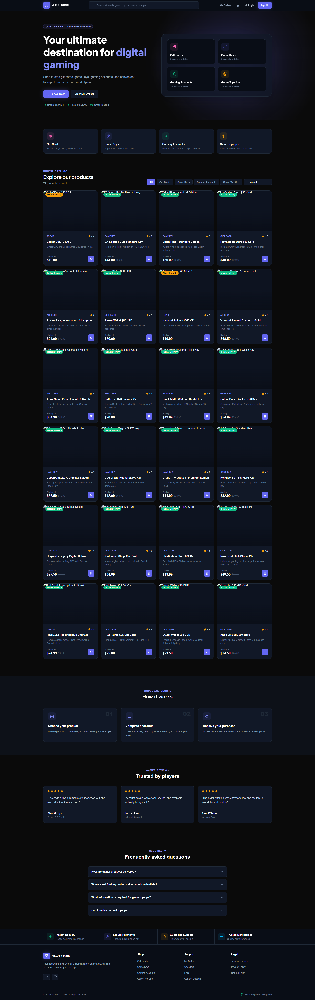
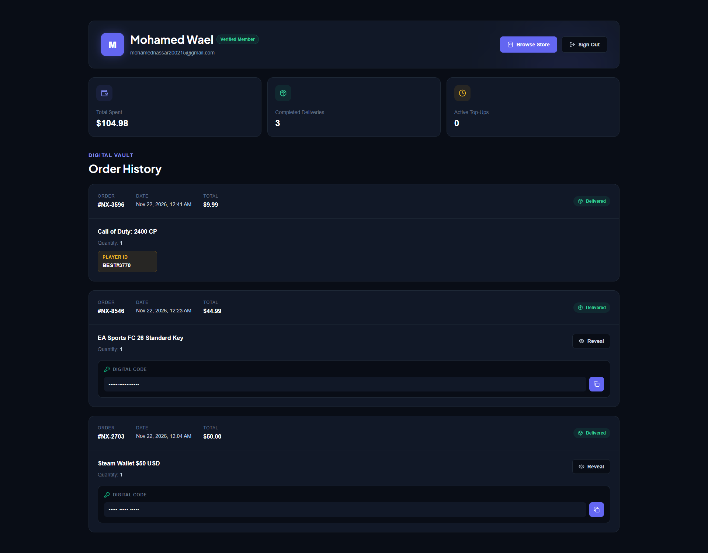
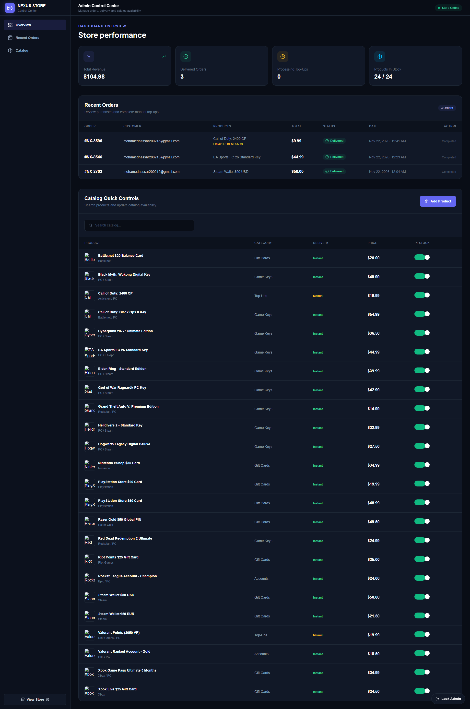

# NEXUS STORE — Full-Stack Digital Gaming Marketplace

## 📸 Screenshots





A modern, full-stack digital gaming e-commerce platform built with **Next.js (App Router)**, **TypeScript**, **Tailwind CSS**, and **Supabase**. Designed with a sleek dark gaming UI, featuring real-time database integration, customer authentication with a personal Digital Vault, and a server-protected Admin Control Center.

🔗 **Live Demo:** [https://nexus-store-beige-mu.vercel.app](https://nexus-store-beige-mu.vercel.app)

---

## ✨ Key Features

### 🛍️ Storefront & Catalog
- **Dynamic Product Catalog:** Powered by **Supabase PostgreSQL**, showcasing 24+ digital gaming products across categories (*Gift Cards, Game Keys, Gaming Accounts, Game Top-Ups*).
- **Instant Search & Filtering:** Real-time search query filtering and category navigation.
- **Interactive Cart & Simulated Checkout:** Full shopping cart state management with an end-to-end simulated checkout flow that persists orders directly to the database.

### 🔐 Customer Authentication & Digital Vault (`/dashboard`)
- **Seamless Auth Modal:** Custom Login & Sign-Up popup powered by **Supabase Auth** with session persistence.
- **Customer Dashboard:** Displays personalized gamertag profile, verified status, and real-time KPI metrics (*Total Spent, Completed Deliveries, Active Top-Ups*).
- **Digital Vault:** Automatically fetches the logged-in customer's orders and provides one-click **Reveal/Hide** and **Copy-to-Clipboard** functionality for digital codes and account credentials.

### 🛡️ Protected Admin Control Center (`/admin`)
- **Complete Role Separation:** Completely decoupled from customer accounts and hidden from public navigation.
- **Server-Side Cookie Gate:** Protected via a dedicated Next.js API Route (`/api/admin-login`) issuing an `httpOnly` session cookie (`nexus_admin_token`) verified against server environment credentials.
- **Store Management:** Manage incoming customer orders, update delivery statuses, and oversee product listings.

---

## 🛠️ Tech Stack

- **Frontend:** Next.js (App Router), React, TypeScript, Tailwind CSS, Lucide Icons
- **Backend & Database:** Next.js API Routes, Supabase (PostgreSQL + Auth)
- **Security:** `httpOnly` Cookies, Server-Side Environment Validation
- **Deployment & CI/CD:** GitHub + Vercel

---

## 🚀 Getting Started Locally

1. **Clone the repository:**
   ```bash
   git clone [https://github.com/mwwael2017/mini-gaming-store.git](https://github.com/mwwael2017/mini-gaming-store.git)
   cd mini-gaming-store
   ```

2. **Install dependencies:**
   ```bash
   npm install
   ```

3. **Configure environment variables:**
   Create a `.env.local` file in the root directory and add:
   ```env
   NEXT_PUBLIC_SUPABASE_URL=your_supabase_project_url
   NEXT_PUBLIC_SUPABASE_ANON_KEY=your_supabase_anon_key
   ADMIN_USERNAME=your_admin_username
   ADMIN_PASSWORD=your_admin_password
   ```

4. **Run the development server:**
   ```bash
   npm run dev
   ```
   Open [http://localhost:3000](http://localhost:3000) in your browser.

---

## 📌 Portfolio Note
This project was built as a full-stack portfolio showcase. The checkout flow simulates payment processing to demonstrate complete order lifecycle management, database persistence, and automated digital delivery inside the Customer Dashboard.
